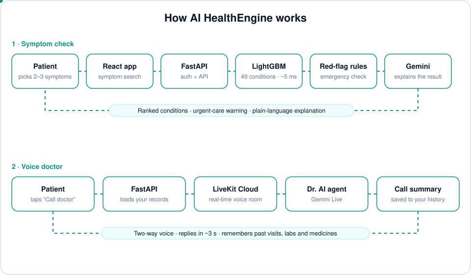

# AI HealthEngine

An AI health platform that predicts likely conditions from a few symptoms, warns when to seek urgent care, and lets patients talk to a voice AI doctor that remembers their history.

**[Live demo](https://ai-healthengine.onrender.com)** · FastAPI · React · MongoDB · LightGBM · Gemini · LiveKit

> ⚕️ For education only. Not a diagnosis or a substitute for a doctor. In an emergency, call 112 / 911.

<p align="center">
  
</p>

## Highlights

- **Symptom checker:** a calibrated LightGBM model trained on [DDXPlus](https://arxiv.org/abs/2205.09148) (1.16M patients, 49 conditions). With just **3 symptoms**, the right condition is in the top 3 for **~97%** of test patients. Predictions take a few milliseconds on one CPU.
- **Urgent-care warnings:** rule-based checks, independent of the model, flag signs like chest pain at rest, fainting or stroke symptoms.
- **Voice AI doctor:** real-time voice calls (LiveKit + Gemini Live). The doctor reads the patient's past visits, lab reports and medicines, and every call is summarised and saved.
- **Gemini tools:** lab report analysis, 4-week health plans, symptom triage, drug interaction checks and a chat assistant.
- **Health records:** medication tracker, health timeline and journal, family profiles, doctor directory with appointments, and PDF / CSV / FHIR export.
- **Live alerts:** WebSocket notifications when an appointment is booked or cancelled, a lab report is analysed, a call summary is ready, or a symptom check finds warning signs.
- **Security:** JWT login with 2FA (TOTP), rate limiting, security headers and prompt-injection filtering.

## Model results

Measured on 116K held-out DDXPlus patients:

| Symptoms entered | Top-1 | Top-3 |
|---|---|---|
| 2 | 67% | 89% |
| 3 | 83% | 97% |
| 4 | 90% | 99% |
| All (~20) | 99.7% | 100% |

Training adds copies of patients cut down to 2–8 symptoms, since real users rarely answer 20 questions. Without them, 3-symptom top-3 accuracy was 57%. The model is 20 MB and uses about 330 MB of RAM, so it fits Render's free tier. See [`training/README.md`](training/README.md) to retrain it.

## Tech stack

| Layer | Tools |
|---|---|
| Frontend | React 18, Vite, Tailwind CSS, Framer Motion, i18next (English + Hindi), PWA |
| Backend | FastAPI, MongoDB (Motor), Pydantic, WebSockets, ReportLab |
| AI / ML | LightGBM, scikit-learn, Google Gemini |
| Voice | LiveKit Agents, Gemini Live, Silero VAD |
| Hosting | Render (app), LiveKit Cloud (voice agent), MongoDB Atlas |

## Project structure

```
backend/         FastAPI app: routes/, services/ (ML, Gemini, red flags), models/ (trained model)
frontend/        React app: pages/, components/, context/, i18n/
livekit-agent/   Voice doctor agent, deployed to LiveKit Cloud
training/        Download DDXPlus and retrain the model
docs/            README assets
```

## Run locally

You need Python 3.10+, Node 18+, a MongoDB database and a Gemini API key. A LiveKit account is needed only for the voice doctor. On macOS, also run `brew install libomp`.

```bash
# Backend: http://localhost:8000
cd backend
python -m venv .venv && source .venv/bin/activate
pip install -r requirements.txt
python main.py

# Frontend: http://localhost:5173
cd frontend
npm install
npm run dev

# Voice agent (optional)
cd livekit-agent
pip install -r requirements.txt
python agent.py dev
```

The trained model is already in the repo, so prediction works straight away.

### Environment variables

`backend/.env`:

```env
MONGO_URI=mongodb+srv://...
SECRET_KEY=any-long-random-string
GEMINI_API_KEY=...
ALLOWED_ORIGINS=http://localhost:5173
ADMIN_EMAIL=you@example.com

# Optional
RESEND_API_KEY=...            # email (or SMTP_EMAIL + SMTP_PASSWORD)
LIVEKIT_URL=wss://your-project.livekit.cloud
LIVEKIT_API_KEY=...
LIVEKIT_API_SECRET=...
BACKEND_PUBLIC_URL=http://localhost:8000
```

`frontend/.env`: `VITE_API_URL=http://localhost:8000`

`livekit-agent/.env`: `LIVEKIT_URL`, `LIVEKIT_API_KEY`, `LIVEKIT_API_SECRET`, `GOOGLE_API_KEY`

## Deployment

`render.yaml` deploys the backend and frontend to Render's free tier. See [DEPLOY.md](DEPLOY.md) for the steps.

## Citation

The model is trained on DDXPlus (CC-BY-4.0):

> Fansi Tchango, A., Goel, R., Wen, Z., Martel, J., & Ghosn, J. (2022). *DDXPlus: A New Dataset For Automatic Medical Diagnosis.* NeurIPS 2022 Datasets and Benchmarks Track.

DDXPlus patients are synthetic, so accuracy on real patients will be lower.
